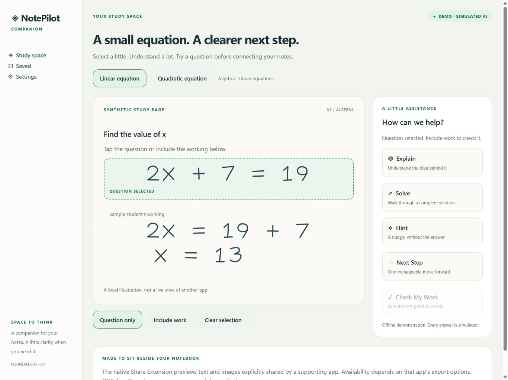

# NotePilot Companion

**A little clarity, right beside your notes.**

A native iPad study companion built with Expo, React Native, TypeScript, and a SwiftUI Share Extension. This is an independent project, created from the official blank Expo template. No source was copied from or changed in `notepilot-ai`.



_Browser preview at 1366 × 1024; not a physical iPad screenshot._

## Why this exists

Switching from handwritten notes into a standalone chatbot interrupts studying. NotePilot explores a smaller interaction: explicitly share a question, choose the kind of help you need, read a temporary explanation, then keep it or return to your work. It is not a notebook replacement.

This repository demonstrates platform research, native extension integration, typed domain boundaries, privacy-aware state management, automated tests, and reproducible development. It is an early foundation, not a claim of production AI or universal note-app integration.

## What works now

- Responsive study space, sidebar/compact navigation, onboarding, settings, and saved explanations.
- Two original synthetic handwritten-style algebra examples rendered with native SVG paths.
- Question-only or question-and-work selection within our own preview. These are preset regions, not OCR or a freeform lasso.
- Explain, Solve, Hint, Next Step, and Check My Work, with explicitly **simulated** responses and scripted follow-ups.
- Temporary response sheets; explicit local saving, deletion, and an option to dismiss responses when the app becomes inactive.
- Provider preferences for Demo, OpenAI, and Anthropic. Live adapters fail closed; no API keys or network tutoring calls.
- Native Share Extension source and an Expo config plugin: one image or plain-text item, local preview, size limits, image downsampling, dismissal, and a separate synthetic demo. Requires a custom native build; **not available in Expo Go**.

Goodnotes, Notability, KilNotes, and Apple Notes are intended integration candidates, not tested or endorsed integrations. Each app controls what it exports. The extension does not read arbitrary notebooks, intercept highlights, observe another app’s Pencil strokes, modify its documents, or create an unrestricted overlay.

## Quick start on Windows

Install Node.js 24 LTS (includes npm) and Git. From this directory:

```powershell
npm ci
npm start
```

Use a compatible Expo Go release on the iPad, on the same network, and open the development URL/QR code. The local demo does not require an Apple Developer membership. Expo Go SDK compatibility must match SDK 58. If a matching client is unavailable, use `npm run web` as a **browser preview**, not evidence of an iPad test.

```powershell
npm run check              # lint, TypeScript, tests with coverage
npm run format:check
npm run build:ios:bundle   # JS/assets only, not a signed app
npm run build:web          # browser preview export
npm run test:plugin        # extension target test using official template fixture
```

The in-app demo sends no study data to providers. Development tooling may contact Expo and package registries; set `EXPO_NO_TELEMETRY=1` to disable Expo CLI telemetry.

## Native build boundary

Windows cannot run Xcode, the iOS Simulator, or Apple's native compiler. Expo also disables iOS prebuild on Windows. On Linux/macOS, `npm run prebuild:ios` generates the app and extension targets; `npm run check:native` verifies the generated project. On a Mac, `npx expo run:ios` installs dependencies and compiles it.

`eas.json` contains simulator, device-development, and production profiles. EAS can compile iOS from a Windows workflow, but simulator binaries cannot run on an iPad. EAS device builds require the appropriate paid Apple Developer membership and signing. A free Personal Team requires Xcode on a Mac and periodic reprovisioning. No EAS jobs, signing purchases, or paid services are triggered by this repository's local checks. Review quota before using cloud builds or the manual macOS workflow.

See [Windows and iPad development](docs/development.md), [platform feasibility](docs/platform-feasibility.md), and [verification record](docs/validation.md).

## Structure

```text
src/app/              Expo Router screens and native shell
src/components/       Preview, response sheet, onboarding, UI primitives
src/domain/           Typed tutoring requests and deterministic examples
src/providers/        Provider boundary; offline adapter and blocked live adapters
src/state/            Versioned storage schema, reducer, serialized writes
native/NotePilotShare/ SwiftUI extension and activation rules
plugins/              Idempotent Xcode target config plugin
scripts/              Native project verification
tests/                Domain, privacy, interactions, plugin fixture
docs/                 Decisions, constraints, security, testing, roadmap
.github/workflows/    Quality pipeline; opt-in unsigned simulator compilation
```

## Roadmap

1. **Foundation:** local synthetic workflow and native share-preview implementation.
2. **Native validation:** compile in Xcode/macOS CI, test on the target iPad, exercise share sheets and resized windows, validate VoiceOver and Pencil interaction.
3. **Real questions:** explicit image/text import, user-reviewed OCR, crop review, cancellation, and an authenticated provider gateway with per-request consent and spending limits.
4. **Supported integrations:** confirm each note app’s export formats; add PDF import and optional App Group handoff where provisioning permits.
5. **Later research:** App Intents, user-approved ScreenCaptureKit capture on supported iPadOS versions, and real-time voice tutoring. Each needs a separate privacy and lifecycle design.

See [architecture](docs/architecture.md), [security](docs/security.md), and [project rules](AGENTS.md). Original work is all rights reserved; third-party Expo template licenses and attribution are retained.
