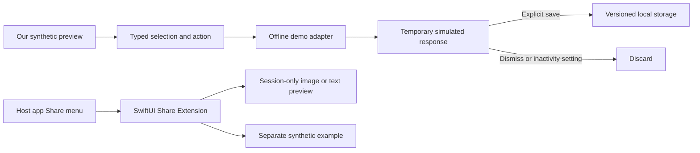

# Architecture decision 001: native companion with a small extension

**Status:** accepted for foundation; native runtime validation pending.

## Decision

Use Expo SDK 58, React Native 0.88, React 19.3, TypeScript, and Expo Router from the current official template/SDK dependency resolver. Keep the app in Continuous Native Generation (CNG). Own a small config plugin that generates an embedded SwiftUI Share Extension target. Do not load React Native inside the extension.

This preserves TypeScript UI/domain work while allowing native-only APIs to be implemented in Swift when needed. A SwiftUI extension is a good fit for a short-lived system-hosted task with modest memory needs. Future capture, OCR, or App Intents can use native modules without rewriting the app. A full SwiftUI app would simplify some Apple-specific surfaces, but would remove the immediate Windows/Expo Go development loop without resolving signing limitations.

## Current data flow



The two entry points deliberately do not exchange shared data yet. No App Group entitlement is required for this phase. An App Group inbox would add persistent shared data, provisioning requirements, cleanup/replay concerns, and a native reader; introduce it only when cross-process handoff is implemented and tested. The extension never uses unsupported techniques to force open the containing app.

## Boundaries

- `domain`: synthetic examples, action types, and deterministic explanations. No I/O or platform dependencies.
- `providers`: asynchronous provider interface, cancellation boundary, and explicit failure for unconfigured live providers. Preferences do not switch the demo into a real service.
- `state`: validated versioned state, explicit saves, 50-item limit, deduplication, privacy deletion. Writes are serialized to prevent an older save from replacing a newer deletion.
- `components` / `app`: presentation and navigation. Response state stays in memory, never in persistence. Request versioning rejects stale results after dismissal/backgrounding.
- `native`: one attachment, 12 MB image file limit, 1,600-pixel thumbnail, 20 KB text limit. No network, disk copy, account, or analytics.
- `plugins`: generates the extension target, source build phase, host dependency, embedded product, and build settings. Generated `ios/` stays ignored.

## Future live AI boundary

```text
Reviewed selection + explicit consent
  → authenticated HTTPS gateway
  → server-only provider adapter and credential store
  → validated structured response with provenance
  → temporary answer with cancellation and expiry
```

Before connecting live providers: implement authentication, strict input/output schemas, upload limits, timeouts, rate/spend caps, deletion policy, prompt-injection handling, and error redaction. Keep provider keys off the device and outside `EXPO_PUBLIC_*`. Use Keychain-backed SecureStore for short-lived session credentials when authentication exists; ordinary AsyncStorage is only for non-sensitive demo state. Provider implementations are intentionally blocked now, not security-complete live adapters.

## Tradeoffs and deferred decisions

Preset regions are reliable for demonstrating selection semantics, but are not a lasso or recognition system. Scripted follow-ups demonstrate progressive help without pretending to understand arbitrary questions. ScreenCaptureKit, voice tutoring, real OCR, PDFs, and host-app interoperability are separate milestones. Multi-window instance management is also deferred; the current shell adapts to a single resized app window.

Sources: [Expo SDK 58](https://docs.expo.dev/versions/v58.0.0/), [Expo Router](https://docs.expo.dev/router/introduction/), [config plugins](https://docs.expo.dev/config-plugins/plugins/), [extension support](https://docs.expo.dev/build-reference/app-extensions/).
