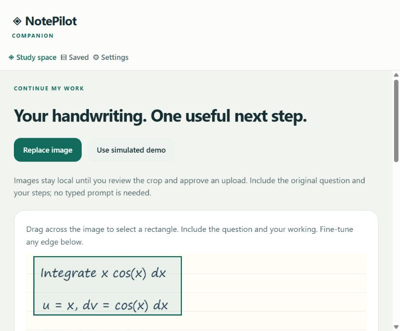

# Milestone 2: image-based tutoring

The existing Expo app now accepts a user-selected screenshot/photo, prepares a JPEG locally, crops it, previews the exact outgoing image, and asks for consent before each request. It never asks students to type a prompt. The Share Extension remains a preview-only component; automatic handoff from it is outside this milestone.

_Browser evidence only; not a native iPad screenshot._

## Data and trust boundaries

1. Expo ImagePicker opens the system image selector without camera or microphone access. Imports are capped at 12 MB / 36 megapixels when metadata is available, then re-encoded at a maximum of 2048 pixels per side.
2. Drag-to-select and accessible edge controls change a normalized crop. ImageManipulator creates the selected JPEG; only this JPEG is sent. The work toggle describes what is in the crop; it does not erase pixels.
3. Each action/follow-up shows the exact crop, destination, provider, and cost/retention notice. “Keep on device” makes no analysis request. Follow-ups also send bounded previous AI feedback.
4. The personal Node gateway validates a bearer access token, exact browser origin, consent, request shape, JPEG dimensions, and a 3 MB image limit. It uses a fixed OpenAI endpoint; arbitrary image URLs and provider URLs are not accepted.
5. The OpenAI Responses API receives the image, action-specific instructions, and a strict JSON schema. Credentials come only from server environment variables. `store: false` is set, but this does not mean OpenAI has zero retention.
6. The response includes the perceived problem, visible-step assessments, stopping point, uncertainty, focused feedback, and one proposed next step. The server replaces unreadable output with a clarification request. AI step assessments are not mathematical proof or an accuracy guarantee.
7. Equations use bundled KaTeX with trust disabled, rendered as MathML (native isolated WebView with JavaScript/network disabled; browser markup). No CDN, remote font, or server rendering call is needed. Text is copied only on explicit action.

## Prompt behavior

- **Next Step:** one useful operation/correction from the student's stopping point. Follow-ups may assume the previous suggestion was applied, but must say so.
- **Check My Work:** evaluate visible steps, identify the first demonstrable error, and explain a local correction without finishing the exercise.
- **Hint:** a conceptual nudge, no final answer.
- **Explain / Explain Further:** explain the concept or preceding feedback.
- **Solve:** a complete solution is allowed.

Handwriting can be ambiguous. Unclear symbols must be listed; unreadable problems produce no invented solution. Prompt constraints reduce over-answering but are not a deterministic mathematical verifier. Real model evaluation is still required.

## Limits and cancellation

The default server allowance is 20 attempted analyses per UTC day, 3 per minute, one active request, and 1,800 maximum output tokens per call. Image byte/dimension limits also bound input size. No automatic retry occurs. Provider failures/cancellations consume the daily attempt allowance because a submitted request may still be billed.

These counters are **in memory, per process**, reset on restart, and are not a durable monetary budget. Keep this single-user gateway private. Before a public/multi-user deployment, add real account/session authentication, persistent atomic quotas, durable spend accounting, deployment hardening, and a reviewed retention policy. Use a dedicated OpenAI project and monitor usage; do not assume an alert is a hard spending cap.

Client cancellation, navigation, and backgrounding abort requests; a request-version guard suppresses late answers. The gateway aborts its upstream request on disconnect or timeout. Cancellation cannot guarantee zero provider charges. The client waits at most 55 seconds; the gateway defaults to 45 seconds.

The app does not persist imported images or gateway tokens in app state. Expo/system image processing can create local temporary cache files. Explicit saves contain unencrypted recognized text, assessments, and answers; deleting a save does not control OS backups or clipboard contents. The server does not log or persist note content. Reverse proxies/hosting services need separate logging/retention review.

## Provider extensibility

`shared/vision.ts` defines the bounded contract. `server/openai.mjs` implements the vision adapter; the HTTP gateway accepts an injected adapter for deterministic tests. Claude and Gemini remain unavailable placeholders and never receive requests. The older sample-only provider interface stays separate so demo content cannot silently impersonate analysis of an imported image.

## Official references checked 2026-10-29

- [OpenAI image inputs and vision limitations](https://developers.openai.com/api/docs/guides/images-vision)
- [OpenAI structured outputs](https://developers.openai.com/api/docs/guides/structured-outputs)
- [Expo SDK 58 ImagePicker](https://docs.expo.dev/versions/v58.0.0/sdk/imagepicker/)
- [Expo SDK 58 ImageManipulator](https://docs.expo.dev/versions/v58.0.0/sdk/imagemanipulator/)
- [Expo Clipboard](https://docs.expo.dev/versions/v58.0.0/sdk/clipboard/)
